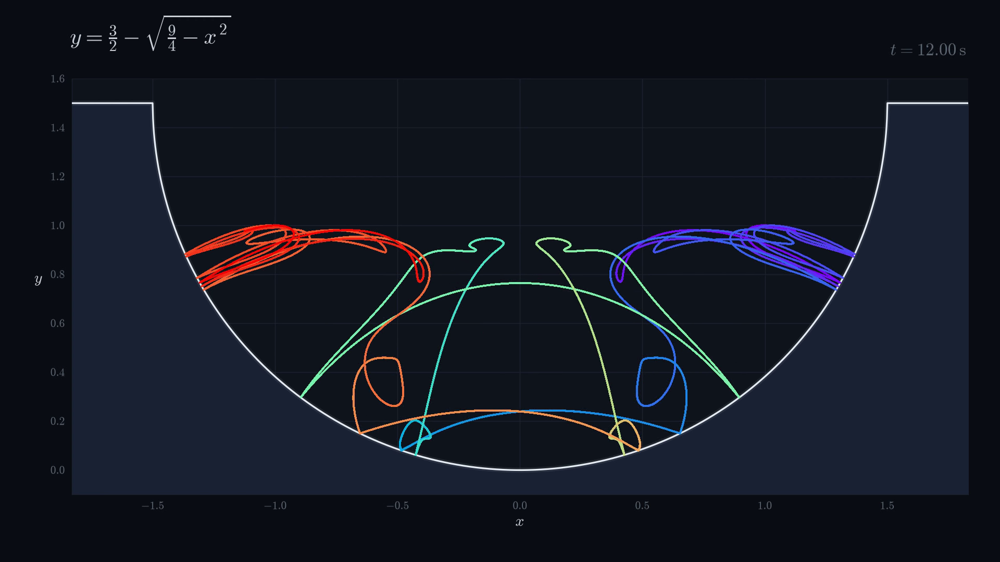
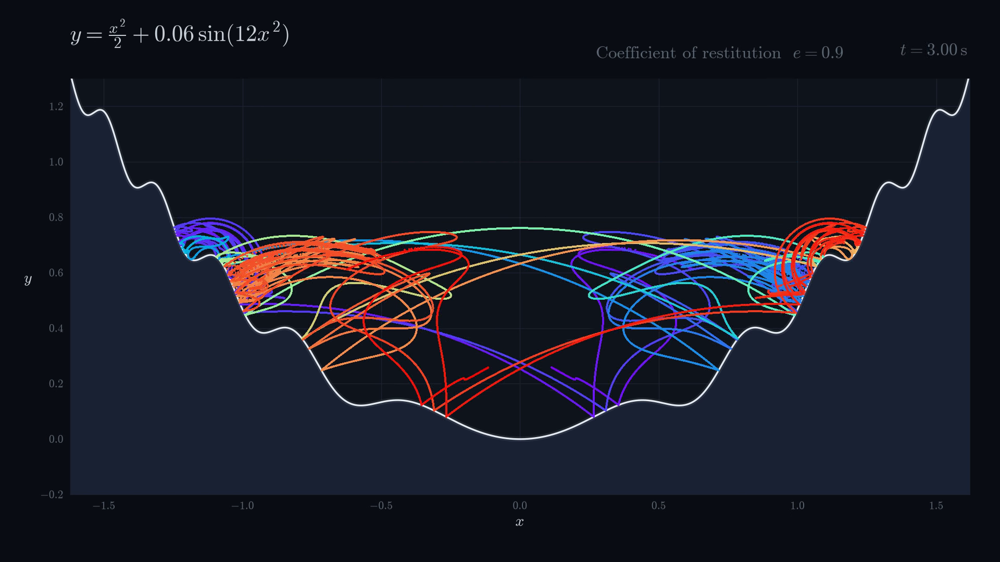

# bouncing-balls

A small test project to get a feel for Mojo: the syntax, the Python interop, and how far you can push GPU compute with it.

Lots of balls drop onto a curve `y = f(x)` and bounce off it. The simulation runs on the GPU, one thread per ball, and the result is rendered to a 1080p video.

## Some frames





## How it works

- `src/ball.mojo`, `src/vec2.mojo`: the plain CPU version of the physics. Handy as a reference.
- `src/gpu_sim.mojo`: the same physics as a GPU kernel (Float32), plus a second kernel that draws the balls straight into an image buffer.
- `src/video.py`: matplotlib draws the static background once (axes, ground, LaTeX labels) and the frames get piped to ffmpeg.

Bounces are solved exactly inside each time step: the ball follows its parabola, the impact time is found by bisection, and the velocity is reflected about the surface normal there. Energy is conserved to float precision when the restitution is 1.

## Running it

You need an NVIDIA GPU with the proprietary driver, [pixi](https://pixi.sh) and ffmpeg.

```
pixi run mojo run main.mojo
```

The video ends up in `outputs/`. Change the function, the plot bounds, the title and the restitution at the top of `main.mojo` and `src/ball.mojo`.

Tested on an RTX 3060 Ti with a Mojo nightly, so some of the GPU API may have moved by the time you read this.
